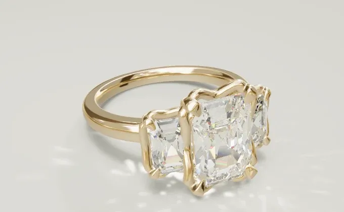

# Mobicat's Jewels

A free, browser-based ring designer and jewelry viewer. Pick a setting, compare cuts at the same carat weight, and rotate the ring under five studio lighting rigs.

**[Open the live viewer](https://jewels.mobicat.club/)**

[](https://jewels.mobicat.club/#v=1&setting=trilogy&cut=emerald&center=natural-diamond&accent=natural-diamond&profile=classic&metal=yellow-gold&carats=1.5&rig=softbox&sparkle=0&eye=-16.71818,29.4,38.93665&target=0,2.4,1.5)

[Open the ring from this clip](https://jewels.mobicat.club/#v=1&setting=trilogy&cut=emerald&center=natural-diamond&accent=natural-diamond&profile=classic&metal=yellow-gold&carats=1.5&rig=softbox&sparkle=0&eye=-16.71818,29.4,38.93665&target=0,2.4,1.5)

## Try it

- **Share this ring** copies the design and camera view. The deployed viewer saves a small JPEG of that view for 90 days so Messages and other link previews can show the ring. The design is in the URL and still opens after the preview expires. If the preview service is unavailable, the viewer copies a design-only link.
- Open **Ring design** to choose among 18 settings, 18 center cuts, 86 gemstone entries and seven metals. On a phone, tap the sliders icon in the bottom toolbar.
- Choose **Fine**, **Classic** or **Bold** under Ring design. Classic is the default. On touchscreens, tapping the center stone opens its cut gallery. **Change gemstone** opens the color library. Each side or pavé stone can have its own gem. Tap the setting to change its metal or choose another style.
- Tap the band or choose **Edit band**. **Shape** changes the cross-section, width and thickness in millimetres. **Shoulders** changes how the band meets the setting. Drag the front and back handles independently, or use the sliders. **Details** controls the finish and edge. Open **Pavé** to set one to three staggered rows, carats per stone for the selected accent material, center-to-center pitch in millimetres and the number of positions on each shoulder. **Graduated** reduces stone size where the band narrows. **Fixed** keeps the chosen size and skips unsupported seats. The panel shows the fitted diameter, stone count and total carat weight, including individually recolored stones. Tap a pavé stone to change its gem or edit the layout. **Reset band** restores the preset. Shared links include the edits.
- Tap **Try on** to use your camera. Show the back of your hand with your fingers spread, then adjust **Visual fit**. The camera, tracking model, and ring render run locally. Closing try-on or leaving the tab stops the camera. Visual fit is an estimate.
- Use **Center weight** to explore 0.50–3.00 ct in 0.05 ct steps. Carats measure mass. Dimensions depend on both the stone’s cut and its density.
- Drag to orbit, scroll or pinch to zoom, and choose **Move ring** to drag it across the floor. The camera panel includes sparkle, depth of field and surface focus. The bottom corner shows the current frame rate during motion.

## Run locally

Use Node.js 22 and npm.

```sh
npm ci
npm run dev
```

Open [the local viewer](http://127.0.0.1:4181/). To exercise the share-preview Worker locally, build the site and run Wrangler dev with local KV. All meshes, lighting and texture assets needed to run it are included.

```sh
npm run build
npm run preview
```

The production build is a static site in `dist/` and can be served from any web host at the domain root. The included Wrangler configuration describes the Mobicat deployment.

## Rendering

The Three.js / WebGL 2 renderer follows refracted and reflected rays through each stone’s facet planes. For complex cuts, a small 3D lookup tells each ray which facet planes it can reach at its next bounce. Pavé stones that share a gem material and shoulder reflection render in one draw call while each stone stays individually selectable. Light absorption depends on distance inside the stone. Shared HDR studio lighting and local reflection probes shade the polished casting. Directional floor caustics are baked for each reference setting and cut, then adjusted for light direction, material and center-stone size at runtime.

Desktop GPUs on the high-detail setting capture 2,048 pixels per face for the metal, 1,536 for the center stone and 768 for each shoulder. Polished highlights sample the packed HDR cube directly. Brushed and hammered metal use a 512-pixel filtered cube source. Orbit and zoom reuse these reflections. Phones use 512-pixel metal and center captures and 256-pixel shoulder captures. [Compare the polished metal at the same zoom](docs/reflection-detail.webp).

Band edits load a detachable setting head for the selected setting and cut. The browser sweeps the edited band, fits the head to the center stone and places the pavé stones and beads on the new surface. Floor caustics use the reference casting’s bake.

The materials estimate at the top uses the volume of the fitted metal and the individual weight and material of every stone. Open the estimate for the breakdown and [pricing references](docs/pricing.md).

During camera motion, depth of field uses a single shaded view and a depth-aware aperture filter. When the camera rests, devices with floating-point render targets progressively add 24 optical views. A contrast-directed resolve smooths reflections during orbit. At rest the renderer integrates eight subpixel samples with a closed aperture. The refitted ring rests on the floor as the center weight changes. Each casting has an offline fit binding with independent displacements for the three profiles and stone size. A smooth spatial cage constrains prong and gallery cross-sections, anchors the bearing to the gemstone, and holds the lower shoulders fixed during carat changes. Carat adjustments are a visual fitting approximation. The tapered claws meet a recessed gallery beneath the center stone. The rail follows the interior between claws and bows out to clear the pavilion. The polished pavé shoulders retain extra mesh samples along both rounded edges. The offline pipeline fits each claw to the crown of its cut before welding the setting to the band.

The `tools/` directory contains the optional offline asset pipeline. Regenerating native CAD starts with a Gemmo Studio source tree containing `crates/gemmo_core`. To rebuild welded settings from a previous raw CAD export, run `python tools/build_jewelry_assets.py PATH_TO_GEMMO_STUDIO --raw PATH_TO_RAW_EXPORT --recast`. The casting export uses Blender 5 and the Python package `meshoptimizer` (tested with `0.2.30a0`). After rebuilding the native assets, run `python tools/build_band_heads.py PATH_TO_RAW_EXPORT PATH_TO_SCRATCH` with NumPy, SciPy and meshoptimizer installed to bind the detachable heads to the rebuilt castings. Running or modifying the web viewer uses the assets in this repository. npm prepares the local tracking runtime before development and production builds. The browser loads the hand model and WebAssembly runtime when someone opens try-on. The try-on uses the visible ring finger to center the band, estimates roll from the palm, and filters position, rotation and diameter separately. A small local image sample refines the fit when both finger edges are distinct.

## Release checks

The [matched renderer comparison](docs/renderer-check.md) includes the round solitaire and emerald-cut trilogy at three camera angles.

| Device | Test | Result |
| --- | --- | --- |
| Desktop Chrome, RTX 5080 | 1440 × 900, rotating pavé trilogy, 60% depth of field | 172–191 FPS across three eight-second runs on the live diamond design |
| Physical iPhone, model and browser unconfirmed | 44-second camera try-on recording | Ring tracking observed. A palm-turn orientation error was reproduced and corrected in local replay. On-device retest and sustained orbit FPS are pending. |
| Physical midrange Android, Chrome | Five-minute orbit and camera try-on | Awaiting device measurement |

To repeat the phone check, [open the pavé trilogy](https://jewels.mobicat.club/#v=1&setting=cluster&cut=round&center=natural-diamond&accent=natural-diamond&aperture=0.6). Start the turntable with the play button, let it run for five minutes and record the FPS readout in the final 30 seconds. Try three setting changes, start camera try-on and return to the studio. Record the model, browser, time to the first usable ring, sustained FPS range and any problems with tapping or camera recovery. The phone target is 30 FPS or higher during orbit.

## License

The viewer code and original generated jewelry assets use the [MIT License](LICENSE). Mobicat’s name and logo identify the project. Three.js retains its [own MIT copyright notice](public/third-party/three-LICENSE.txt).

The tracking runtime is Google’s MediaPipe Tasks Vision ([Apache 2.0 notice](public/third-party/mediapipe-LICENSE.txt)). The bundled hand model is the Google float16 v1 [Hand Landmarker model](https://storage.googleapis.com/mediapipe-models/hand_landmarker/hand_landmarker/float16/1/hand_landmarker.task).
