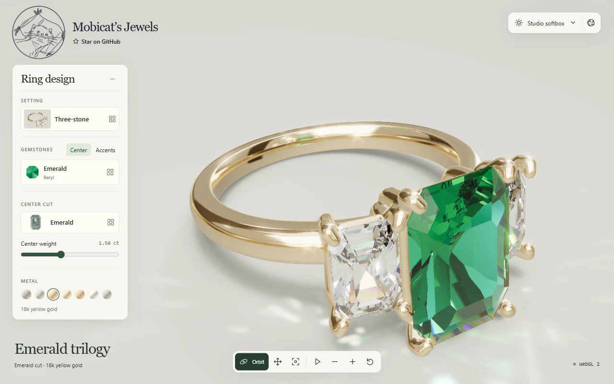

# Mobicat’s Jewels

A free, browser-based ring designer and jewelry viewer. Pick a setting, compare cuts at the same carat weight, and rotate the ring under four studio lighting rigs.

**[Open the live viewer](https://jewels.mobicat.club/)**



## Try it

- Open **Ring design** to choose among 18 settings, 18 center cuts, 86 gemstone entries and seven metals. On a phone, tap the sliders icon in the bottom toolbar.
- Tap or click a stone to change its material. Each side or pavé stone can have its own gem. Tap the band to choose a metal or change the setting.
- Tap **Try on** to use your camera. Show the back of your hand with your fingers spread, then adjust **Visual fit**. The camera, tracking model, and ring render run locally. Closing try-on or leaving the tab stops the camera. Visual fit is an estimate.
- Use **Center weight** to explore 0.50–3.00 ct in 0.05 ct steps. Carats measure mass. Dimensions depend on both the stone’s cut and its density.
- Drag to orbit, scroll or pinch to zoom, and choose **Move ring** to drag it across the floor. The camera panel includes sparkle, depth of field and surface focus. The bottom corner shows the current frame rate during motion.

## Run locally

Use Node.js 22 and npm.

```sh
npm ci
npm run dev
```

Open [the local viewer](http://127.0.0.1:4181/). All meshes, lighting and texture assets needed to run it are included.

```sh
npm run build
npm run preview
```

The production build is a static site in `dist/` and can be served from any web host at the domain root. The included Wrangler configuration describes the Mobicat deployment.

## Rendering

The Three.js / WebGL 2 renderer follows refracted and reflected rays through each stone’s facet planes. Light absorption depends on distance inside the stone. Shared HDR studio lighting and local reflection probes shade the polished casting. Directional floor caustics are baked for each reference setting and cut, then adjusted for light direction, material and center-stone size at runtime.

During camera motion, depth of field uses a single shaded view and a depth-aware aperture filter. When the camera rests, devices with floating-point render targets progressively add 24 optical views. The refitted ring rests on the floor as the center weight changes. Carat adjustments are a visual fitting approximation.

The `tools/` directory contains the optional offline asset pipeline. Regenerating native CAD starts with a Gemmo Studio source tree containing `crates/gemmo_core`. Running or modifying the web viewer uses the assets in this repository. npm prepares the local tracking runtime before development and production builds. The browser loads the hand model and WebAssembly runtime when someone opens try-on.

## License

The viewer code and original generated jewelry assets use the [MIT License](LICENSE). Mobicat’s name and logo identify the project. Three.js retains its [own MIT copyright notice](public/third-party/three-LICENSE.txt).

The tracking runtime is Google’s MediaPipe Tasks Vision ([Apache 2.0 notice](public/third-party/mediapipe-LICENSE.txt)). The bundled hand model is the Google float16 v1 [Hand Landmarker model](https://storage.googleapis.com/mediapipe-models/hand_landmarker/hand_landmarker/float16/1/hand_landmarker.task).
