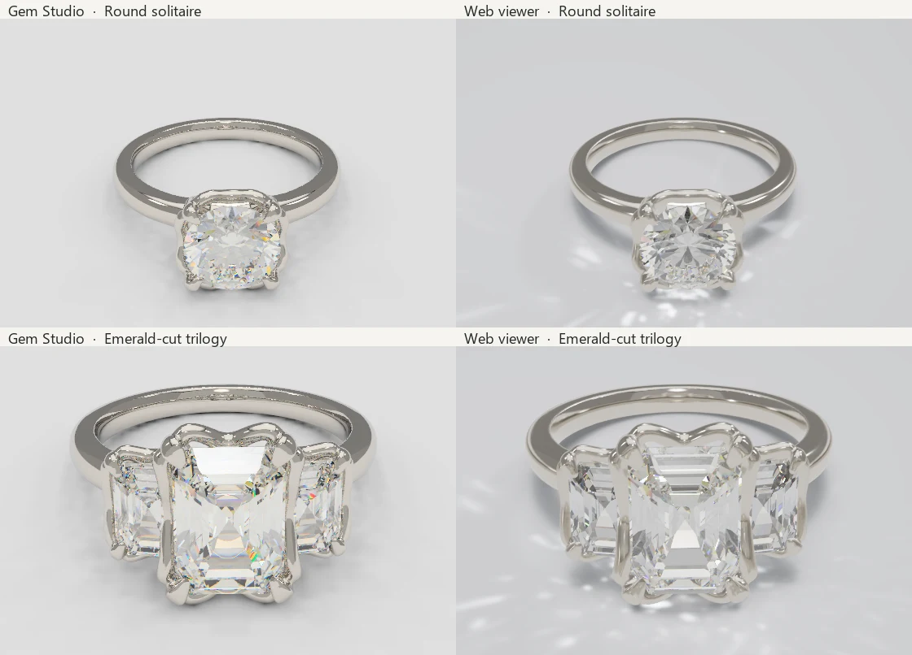
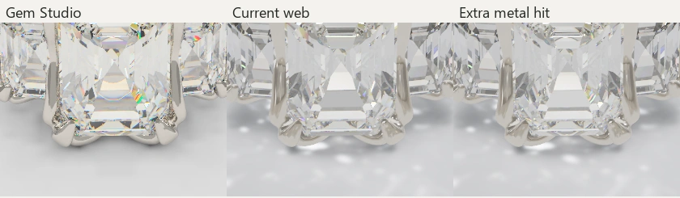

# Ring renderer comparison

[View the three camera angles](renderer-angles.webp)

The comparison uses 1.50 ct natural diamonds and platinum. The desktop reference is Gem Studio’s CPU implementation of its live jewelry shader, with nine wavelengths and four camera samples. Both renderers use the web viewer’s fitted metal vertices and normals, stone poses, camera position, field of view and framing. The desktop traces the Studio light panels directly. The browser uses a panorama sampled from those same panels and floor at the center stone. The web floor, shadow treatment and display curve remain those of the viewer. Focus blur and the decorative sparkle pass are off to expose the facets.

The round solitaire shows a darker central pattern in the browser as the viewing angle changes. In the emerald-cut trilogy the browser’s prong silhouettes and dark inner band are stronger, while the reference gives the table a broader bright reflection. Increasing geometric detail alone would leave much of that difference intact.

## One additional intersection

The experiment traces the first significant exit of each center-gem color channel against the fitted casting’s triangle tree. At a hit it interpolates the polished surface normal and looks up the reflected studio light. The prototype was tested with platinum and stays outside the shipped viewer.

At ordinary viewing size the change was small across the three angles. The prong-adjacent facets changed in close-up, while the broader contrast difference remained. On an RTX 5080 at 560 × 380, six alternating 32-frame batches had median frame times of roughly **0.9 ms** for the public shader and **2.7 ms** for the experiment. Each batch included a synchronous pixel read to wait for GPU completion. This measures rendering work on the desktop, independently of the monitor’s refresh rate. The current release retains the existing shader.
